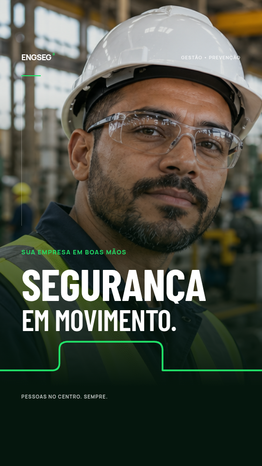

# ENGSEG + EFICAZ — Motions

Dois vídeos corporativos completos, produzidos em Remotion: **24 segundos cada, 1080 × 1920, 30 fps, MP4 com áudio estéreo**. Incluem tipografia animada, transições, trilhas instrumentais e efeitos sonoros.

## Baixar os arquivos

| Entrega | Download |
| --- | --- |
| Vídeo ENGSEG | [Baixar MP4](https://github.com/thiagobc2026/teste/raw/refs/heads/main/entregas/ENGSEG-Motion.mp4) |
| Vídeo EFICAZ | [Baixar MP4](https://github.com/thiagobc2026/teste/raw/refs/heads/main/entregas/EFICAZ-Motion.mp4) |
| Projeto Remotion completo | [Baixar ZIP editável](https://github.com/thiagobc2026/teste/raw/refs/heads/main/entregas/Projeto-Remotion-ENGSEG-EFICAZ.zip) |

O ZIP inclui código-fonte, cenas, imagens, fontes, trilhas e efeitos. Não é necessário executar o projeto para assistir aos MP4s.

## Abrir o projeto

Requisitos: Node.js 22 ou superior.

```sh
git clone https://github.com/thiagobc2026/teste.git
cd teste/Projeto-Remotion-ENGSEG-EFICAZ
npm ci
npm run studio
```

No Remotion Studio, selecione `ENGSEG-Motion` ou `EFICAZ-Motion`. Consulte o [README do projeto](Projeto-Remotion-ENGSEG-EFICAZ/README.md) para exportação e edição.

As fotografias são ilustrativas, geradas para o projeto, e não representam os funcionários ou as instalações reais das empresas. Cores, serviços e contatos foram baseados nas referências fornecidas.

## Prévias

| ENGSEG | EFICAZ |
| --- | --- |
|  |  |
