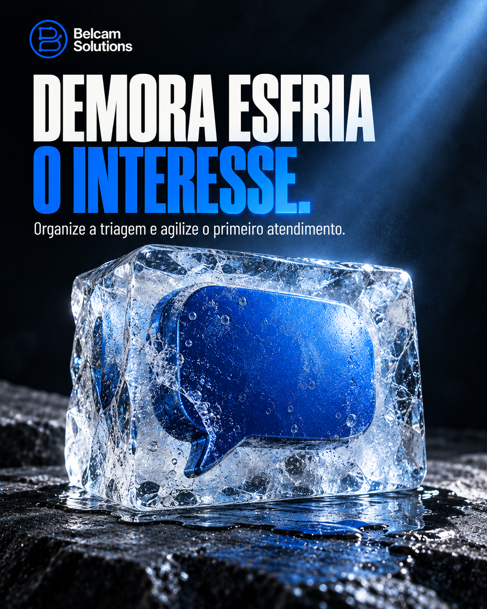
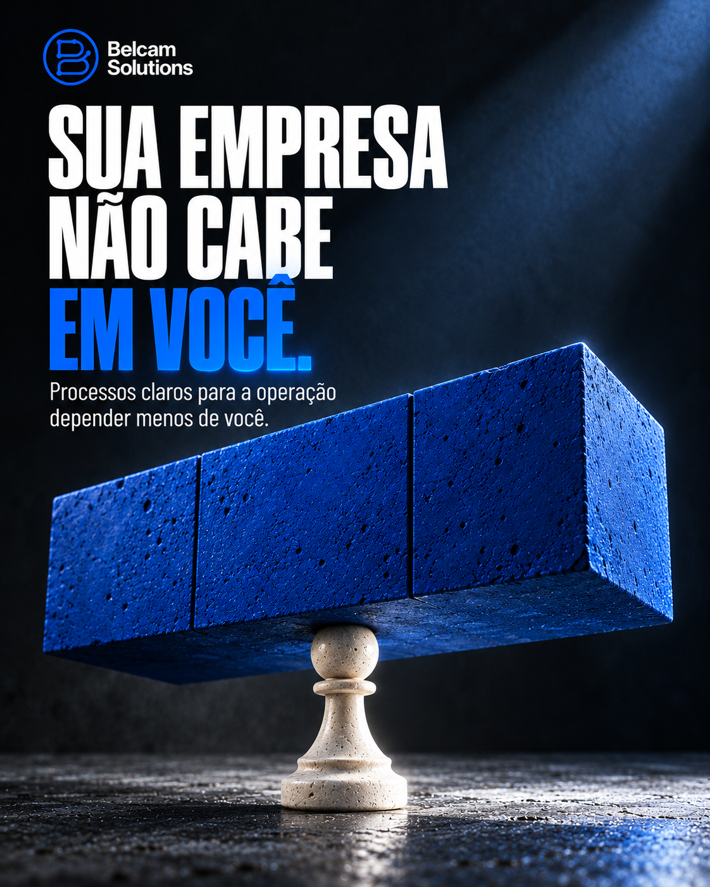
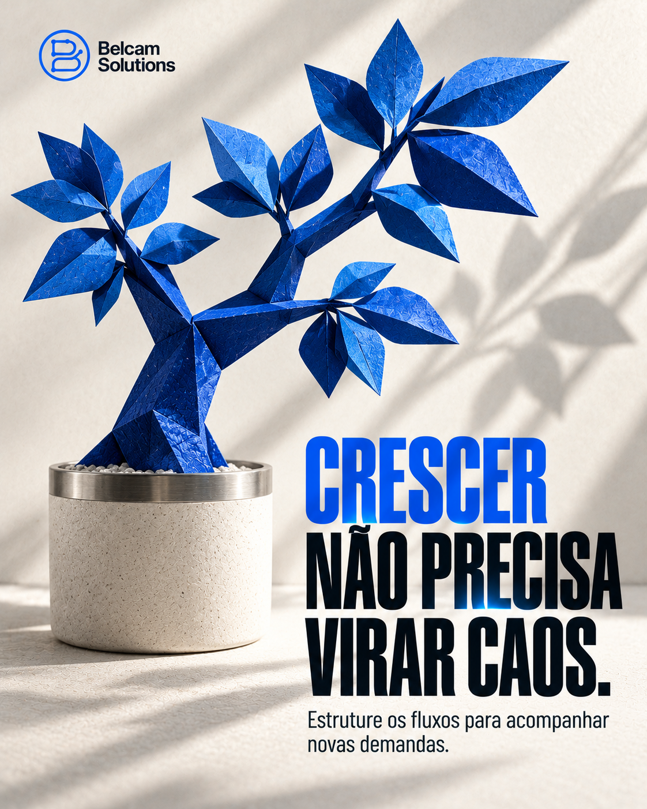

# Belcam Solutions — 12 posts para feed

**Mais seis artes: posts 07 a 12, voltados aos desafios dos clientes.**

- [Baixar somente os seis novos posts — 07 a 12](https://github.com/thiagobc2026/teste/raw/refs/heads/main/entregas/belcam-solutions-feed/Belcam-Solutions-Posts-07-a-12.zip)
- [Baixar a coleção completa — 12 posts](https://github.com/thiagobc2026/teste/raw/refs/heads/main/entregas/belcam-solutions-feed/Belcam-Solutions-12-Posts.zip)
- [Coleção inicial — posts 01 a 06](https://github.com/thiagobc2026/teste/raw/refs/heads/main/entregas/belcam-solutions-feed/Belcam-Solutions-6-Posts.zip)

Objetos 3D, materiais com textura, a mesma tipografia condensada e luz azul integrada aos títulos. Composições claras e escuras em azul elétrico, grafite, branco e prata.

PNG · 1122 × 1402 pixels · RGB · Vertical próximo de 4:5.

## Novos posts — 07 a 12

| | | |
| :---: | :---: | :---: |
|  **07 · Agilidade no atendimento** |  **08 · Acompanhamento de propostas** |  **09 · Redução de retrabalho** |
|  **10 · Visibilidade das oportunidades** |  **11 · Menos dependência do dono** |  **12 · Crescimento com organização** |

## Coleção inicial — 01 a 06

| | | |
| :---: | :---: | :---: |
|  **01 · Melhoria de processos** |  **02 · Automação de tarefas** |  **03 · Funis de vendas** |
|  **04 · Captação e organização de leads** |  **05 · Integração de ferramentas** |  **06 · Dica de diagnóstico de processos** |

## Conceitos das novas artes

| Post | Imagem | Tema |
| --- | --- | --- |
| 07 | Balão de conversa congelado em um bloco de gelo | Agilidade no atendimento |
| 08 | Vírgula azul saindo de um envelope de papel | Acompanhamento de propostas |
| 09 | Tesoura cortando uma sequência de formulários de papel | Redução de retrabalho |
| 10 | Binóculo de metal azul com reflexos de etapas comerciais | Visibilidade das oportunidades |
| 11 | Peão de xadrez sustentando um grande bloco azul | Menos dependência do dono |
| 12 | Árvore de papel azul com galhos bem estruturados | Crescimento com organização |

## Arquivos

- Doze PNGs individuais.
- [Legendas dos novos posts](legendas-07-a-12.txt) e [todas as legendas](legendas.txt).
- `index.html`: galeria local; extraia o ZIP e abra no navegador.
- [Informações da entrega](LEIA-ME.txt).
- `verificacao.json`: dimensões e hashes dos arquivos.
