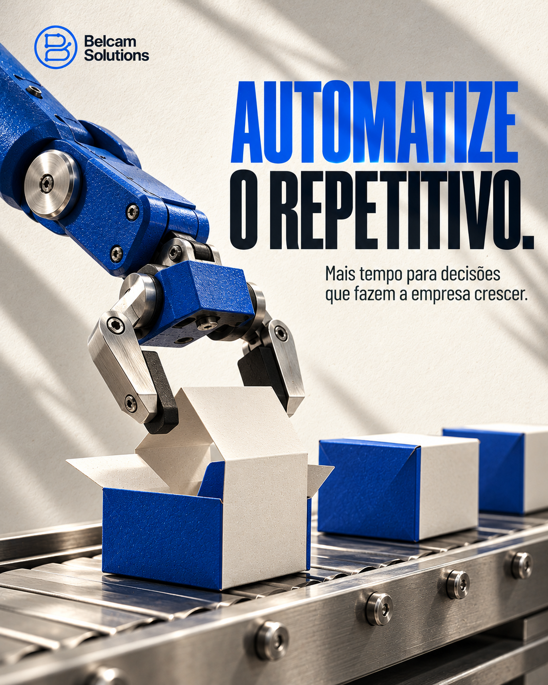

# Belcam Solutions — Feed

**34 artes para Instagram.**

[Voltar ao acervo](../README.md) · [Abrir Stories](../stories/README.md)

| | | |
| :---: | :---: | :---: |
|  01 destrave sua operacao |  02 automatize o repetitivo |  03 cada etapa tem um proximo passo |
|  04 contatos nao podem se perder |  05 ferramentas diferentes um so fluxo |  06 primeiro clareza depois automacao |
|  07 demora esfria o interesse |  08 a proposta nao e o ponto final |  09 copiar colar repetir ate quando |
|  10 vendas sem ponto cego |  11 sua empresa nao cabe em voce |  12 crescer nao precisa virar caos |
|  13 ia com direcao |  14 dados confiaveis |  15 pos venda |
|  16 automacao acompanhada |  17 sua ia entende audio |  18 quando chamar uma pessoa |
|  19 leads mais certos |  20 agenda com buracos |  21 vendeu entrou no caixa |
|  22 cliente repete tudo |  23 formulario ajuda ou espanta |  24 black friday seu fluxo aguenta |
|  25 toda duvida comeca do zero |  26 onde o cliente desiste |  27 informacao antes do problema |
|  28 qual fluxo simplificar |  |  |

## CRM — Área comercial

[Abrir campanha e legendas](crm/README.md)

| | | |
| :---: | :---: | :---: |
|  01 funil de vendas |  02 whatsapp integrado |  03 fluxos e automacoes |
|  04 follow ups e agenda |  05 indicadores e metas |  06 resumos com ia |

## Variações para LinkedIn

Oito arquivos horizontais: quatro com retrato e quatro revisados sem retrato. As peças com retrato correspondem aos Stories 13–16; as revisadas têm os Stories L01–L04.

| | | |
| :---: | :---: | :---: |
|  13 ia com direcao |  14 dados confiaveis |  15 pos venda |
|  16 automacao acompanhada |  01 o que automatizar primeiro |  02 qualidade dos dados |
|  03 pos venda com continuidade |  04 quem acompanha a automacao |  |

## Textos para publicação

- [belcam-solutions-feed/legendas-07-a-12.txt](textos/belcam-solutions-feed/legendas-07-a-12.txt)
- [belcam-solutions-feed/legendas.txt](textos/belcam-solutions-feed/legendas.txt)
- [belcam-solutions-feed-2026-10/legendas.md](textos/belcam-solutions-feed-2026-10/legendas.md)
- [belcam-solutions-feed-2026-10/pautas-e-interacoes.md](textos/belcam-solutions-feed-2026-10/pautas-e-interacoes.md)
- [belcam-solutions-feed-2026-10/referencias-editoriais.md](textos/belcam-solutions-feed-2026-10/referencias-editoriais.md)
- [instagram-linkedin/legendas-instagram.md](textos/instagram-linkedin/legendas-instagram.md)
- [instagram-linkedin/legendas-linkedin.md](textos/instagram-linkedin/legendas-linkedin.md)
- [linkedin-sem-retrato/legendas-linkedin.md](textos/linkedin-sem-retrato/legendas-linkedin.md)

## Carrosséis do CRM

[Abrir três carrosséis, páginas e legendas](carrosseis/README.md)

