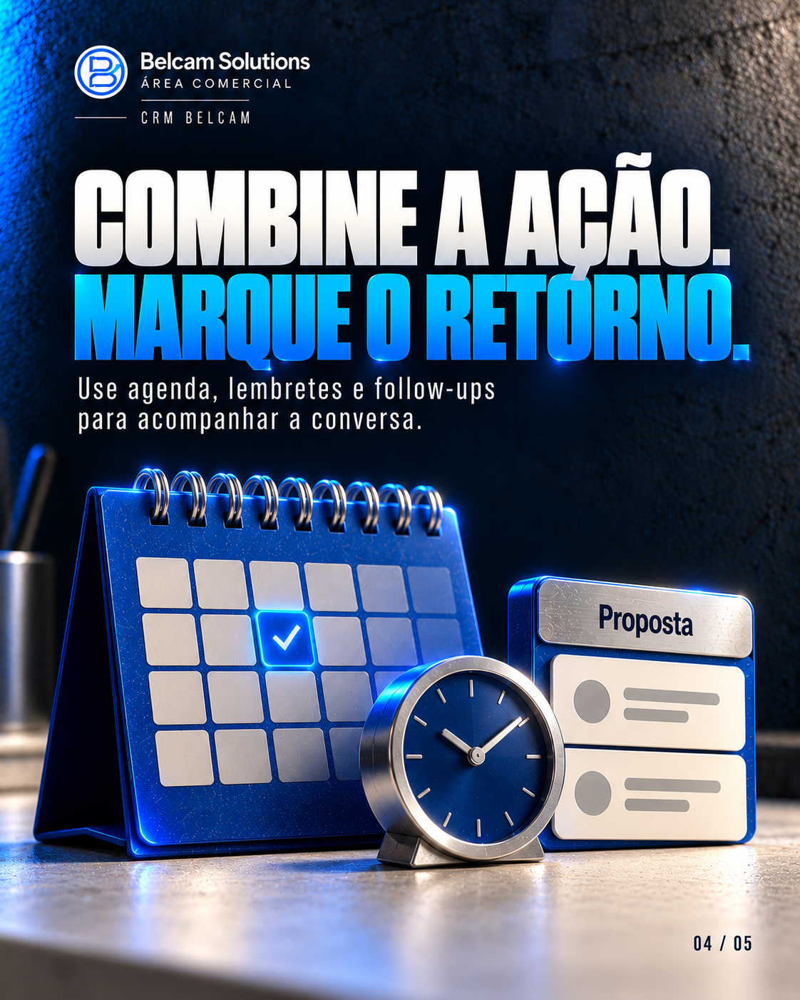

# O lead chegou. E agora?

Carrossel de cinco páginas · Feed vertical 4:5.

[Todos os carrosséis](../README.md)

## Legenda

O lead chegou, mas o trabalho comercial continua. Um funil útil mostra onde cada negociação está, qual ação vem depois e quando retomar o contato. No CRM da Belcam Solutions, você acompanha oportunidades, organiza retornos e consulta o andamento da operação. Qual etapa mais trava hoje: primeiro contato, proposta ou retorno? Conte nos comentários. Para conhecer a ferramenta, fale com a Belcam Solutions.

## Páginas na ordem de publicação

### 01 — O LEAD CHEGOU. E AGORA?

Um próximo passo claro faz diferença no acompanhamento.

### 02 — DÊ NOME ÀS ETAPAS.

Contato, proposta e contrato: organize o caminho da negociação.

### 03 — DEFINA O PRÓXIMO PASSO.

O que precisa acontecer para essa oportunidade avançar?

### 04 — COMBINE A AÇÃO. MARQUE O RETORNO.

Use agenda, lembretes e follow-ups para acompanhar a conversa.

### 05 — QUAL ETAPA MAIS TRAVA?

Contato, proposta ou retorno? Comente sua escolha.

## Arquivos

Resolução nativa: 1122 × 1402 px. Textos e numeração integrados à arte.

[Baixar as cinco páginas e a legenda](carrossel-completo.zip?raw=true)
