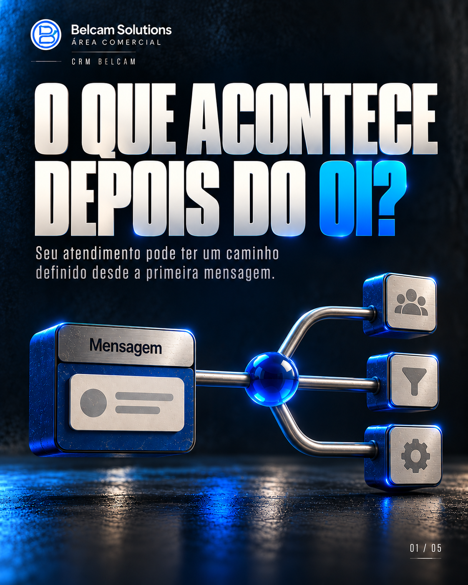
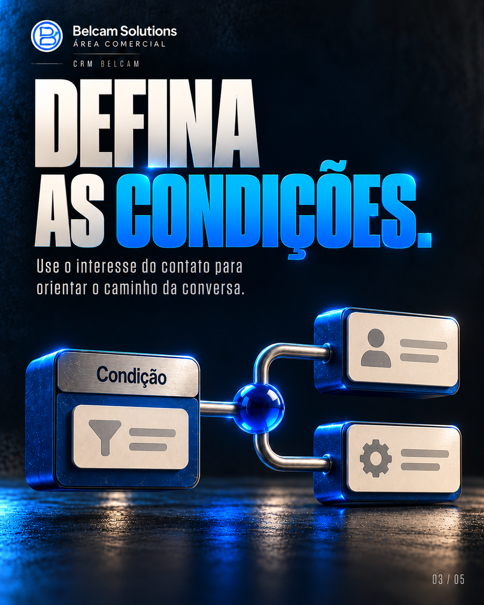
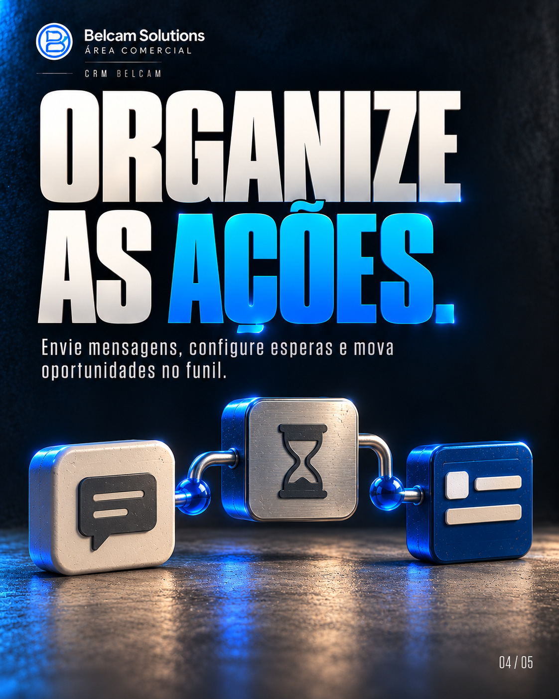

# O que acontece depois do oi?

Carrossel de cinco páginas · Feed vertical 4:5.

[Todos os carrosséis](../README.md)

## Legenda

Automação começa com uma decisão sobre o caminho do atendimento. Uma nova mensagem pode iniciar um fluxo; as condições orientam a sequência; mensagens, esperas e ações no funil organizam a continuidade. No CRM da Belcam Solutions, os fluxos também podem prever encaminhamento para uma pessoa. Comece pelo que mais se repete, teste os caminhos e acompanhe a operação. Qual parte você organizaria primeiro: triagem, encaminhamento ou retorno? A Belcam Solutions ajuda a construir esse fluxo.

## Páginas na ordem de publicação

### 01 — O QUE ACONTECE DEPOIS DO OI?

Seu atendimento pode ter um caminho definido desde a primeira mensagem.

### 02 — ESCOLHA A ENTRADA.

Uma nova mensagem pode ser o início do fluxo de atendimento.

### 03 — DEFINA AS CONDIÇÕES.

Use o interesse do contato para orientar o caminho da conversa.

### 04 — ORGANIZE AS AÇÕES.

Envie mensagens, configure esperas e mova oportunidades no funil.

### 05 — SAIBA QUANDO ENTRA UMA PESSOA.

Preveja atendimento humano para dúvidas e situações fora do fluxo.

## Arquivos

Resolução nativa: 1122 × 1402 px. Textos e numeração integrados à arte.

[Baixar as cinco páginas e a legenda](carrossel-completo.zip?raw=true)
