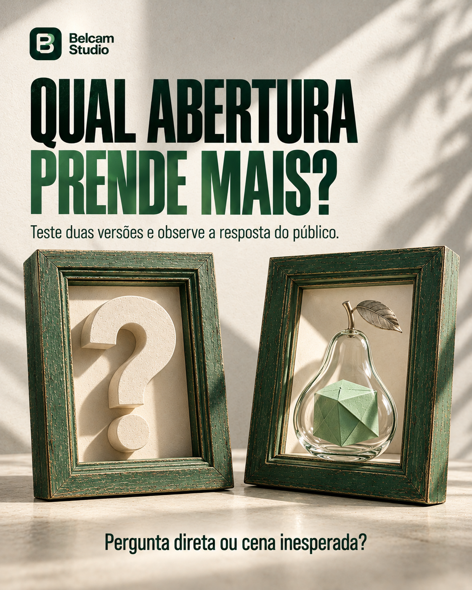

# Belcam Studio — Novos posts para feed

**Lote em produção: 6 de 12 novas artes disponíveis.**

Artes com objetos 3D, materiais com textura, tipografia consistente e luz integrada aos títulos. Cada peça inclui uma pergunta ou escolha para incentivar comentários.

PNG · RGB · Vertical próximo de 4:5 · Resolução original preservada.

| | | |
| :---: | :---: | :---: |
|  **22 · Aberturas de vídeos curtos** |  **23 · Tendências com identidade** |  **24 · Legendas e leitura sem áudio** |
|  **25 · Personalidade de mascotes** |  **26 · Bastidores e processo criativo** |  **27 · Teste de ideias para vídeos** |

## Materiais de apoio

- [Legendas para copiar](legendas.md).
- [Pautas e perguntas de interação](pautas-e-interacoes.md).
- [Referências editoriais e contexto dos temas](referencias-editoriais.md).
- `index.html`: galeria local; extraia o ZIP e abra no navegador.
- `verificacao.json`: dimensões e hashes dos PNGs.

Esta pasta reúne somente a nova coleção. Os arquivos anteriores continuam nas respectivas pastas do repositório.
