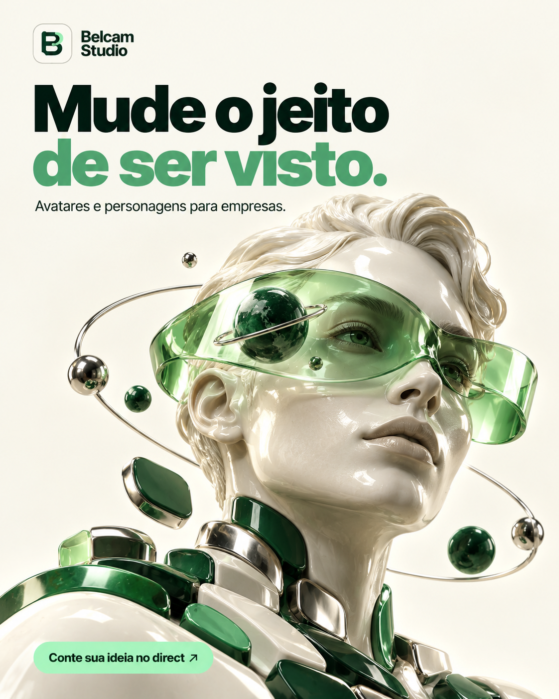
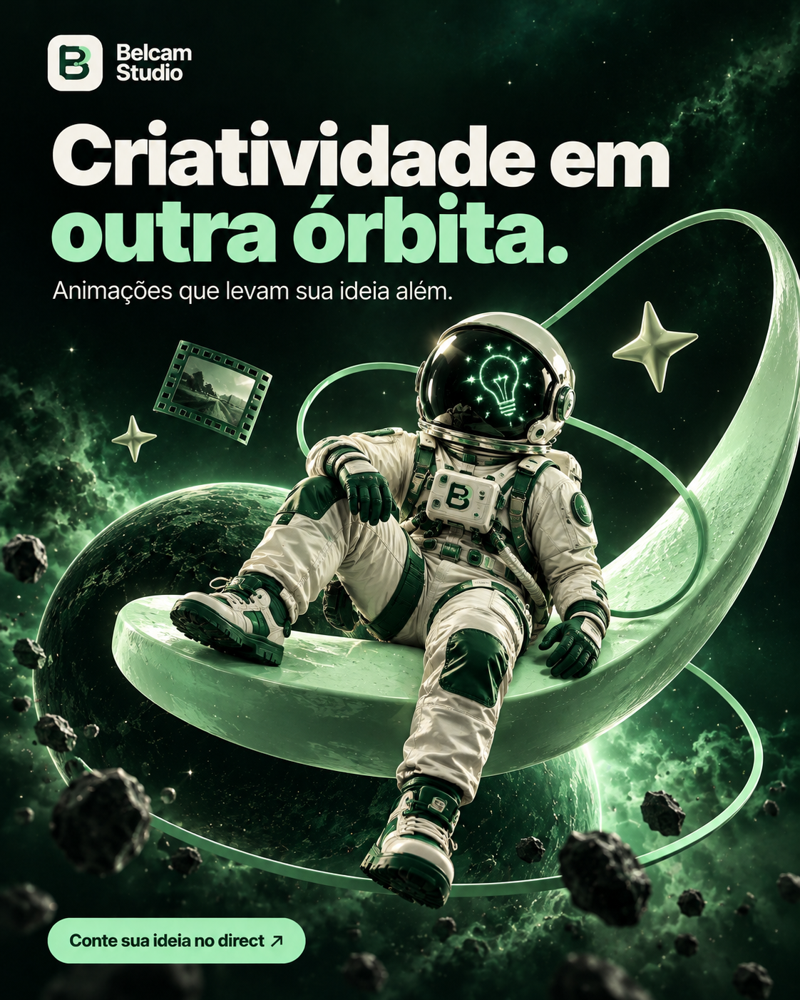

# Belcam Studio — Artes para feed

Nove artes individuais em PNG, com a identidade do Belcam Studio e composições 3D.

**[Baixar a coleção completa em ZIP](Belcam-Studio-Feed.zip?raw=true)**

Inclui as nove imagens, a galeria HTML, nove sugestões de legenda e três roteiros curtos. As imagens têm 1122 × 1402 pixels.

## Prévia da coleção

| 01 · Xadrez | 02 · Quebra-cabeça | 03 · Criatividade |
| :---: | :---: | :---: |
|  |  |  |
|  |  |  |
|  |  |  |

## Arquivos

- `01` a `09`: artes individuais em PNG.
- `index.html`: galeria local. Baixe o ZIP, extraia e abra este arquivo no navegador.
- [Legendas e roteiros](legendas-e-roteiros.txt): textos sugeridos para acompanhar a coleção.
- `LEIA-ME.txt`: informações dos arquivos.

Referências: imagens 1-thi.png, 2thi.png, 3 thi.png e 4 thi.png fornecidas no repositório e a identidade Belcam enviada na conversa.
