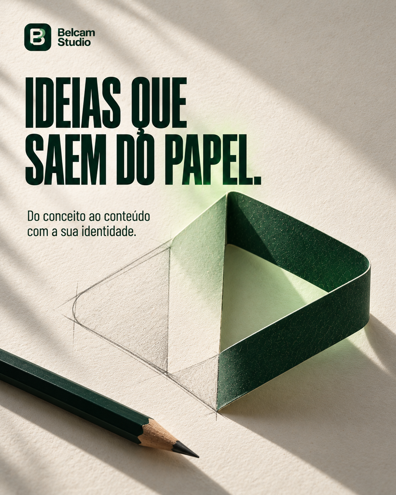
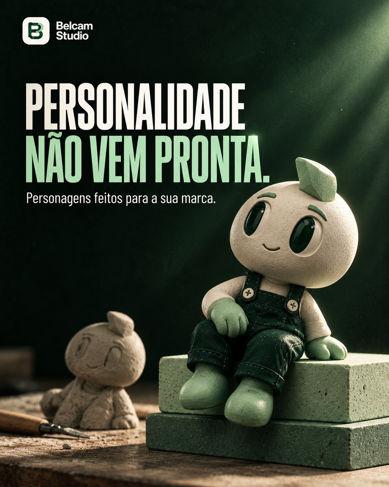

# Belcam Studio — Coleção para feed

**18 artes: nove refinadas e nove novos posts.**

**[Baixar a coleção completa em ZIP](Belcam-Studio-Feed.zip?raw=true)**

As artes 01–09 receberam acabamento refinado e rodapés limpos. Os posts 10–18 trazem novos temas na mesma identidade visual. A coleção mantém a tipografia condensada e a integração de luz e textura aos títulos.

PNGs individuais em 1122 × 1402 pixels. O ZIP inclui galeria HTML, 18 legendas e três sugestões de roteiro.

## Artes refinadas

| | | |
| :---: | :---: | :---: |
|  **01 · A PRÓXIMA JOGADA É SER LEMBRADO.** |  **02 · CADA PEÇA. A SUA CARA.** |  **03 · IDEIAS FORA DO ÓBVIO.** |
|  **04 · ACENDA UMA IDEIA. DÊ PLAY.** |  **05 · SUA MARCA GANHOU PERSONALIDADE.** |  **06 · MUDE O JEITO DE SER VISTO.** |
|  **07 · CRIATIVIDADE EM OUTRA ÓRBITA.** |  **08 · SUA VERBA MERECE UMA BOA IDEIA.** |  **09 · SUA MARCA. EM MOVIMENTO.** |

## Novos posts

| | | |
| :---: | :---: | :---: |
|  **10 · IDEIAS QUE SAEM DO PAPEL.** |  **11 · DÊ VOZ À SUA MARCA.** |  **12 · HISTÓRIAS QUE GANHAM FORMA.** |
|  **13 · UMA IDEIA. VÁRIOS FORMATOS.** |  **14 · O DETALHE FAZ A DIFERENÇA.** |  **15 · PERSONALIDADE NÃO VEM PRONTA.** |
|  **16 · MOVIMENTO COM INTENÇÃO.** |  **17 · MUDE O PONTO DE VISTA.** |  **18 · SUA IDEIA MERECE ACONTECER.** |

## Arquivos

- `01` a `09`: peças anteriores refinadas.
- `10` a `18`: novos posts.
- `index.html`: galeria local. Baixe o ZIP, extraia e abra este arquivo no navegador.
- [Legendas e roteiros](legendas-e-roteiros.txt): textos sugeridos para a coleção.
- `LEIA-ME.txt`: informações dos arquivos.

As versões anteriores permanecem no histórico do GitHub.
