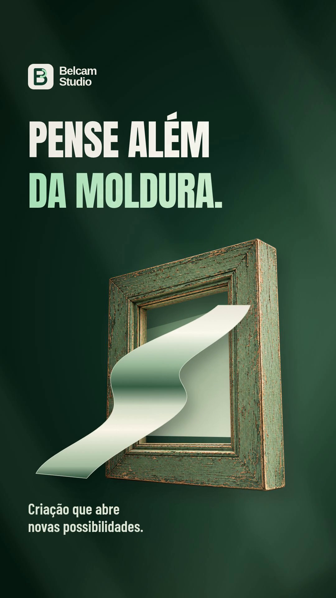

# Belcam Studio — 3 motions para Stories

**MP4 · 1080 × 1920 · 9:16 · 12 segundos cada · 30 fps · áudio estéreo**

[Baixar os três vídeos em ZIP](Belcam-Studio-3-Stories.zip?raw=true) · [Baixar o projeto editável](Belcam-Studio-Projeto-Editavel.zip?raw=true) · [Ver os três novos posts para feed](../belcam-studio-feed/README.md)

Os vídeos incluem movimento dos elementos, títulos animados, iluminação, textura e uma trilha original discreta. Sem locução.

| 01 · Dê asas à sua história | 02 · Pense além da moldura | 03 · Ideias ganham vida |
| :---: | :---: | :---: |
|  |  |  |
| [Baixar MP4](01-de-asas-a-sua-historia.mp4?raw=true) | [Baixar MP4](02-pense-alem-da-moldura.mp4?raw=true) | [Baixar MP4](03-ideias-ganham-vida.mp4?raw=true) |

## Conceitos

- **Dê asas à sua história.** Uma ave de origami feita de película entra em voo; tipografia e luz se revelam em camadas.
- **Pense além da moldura.** Uma fita de papel atravessa a moldura, com movimento contínuo e iluminação em verde e marfim.
- **Ideias ganham vida.** Papéis atravessam uma ampulheta e formam uma borboleta, que ganha o quadro.

## Assistir e editar

Baixe o ZIP dos vídeos, extraia e abra `index.html` para assistir aos três filmes. Também é possível baixar cada MP4 individualmente.

O projeto editável inclui o código Remotion, os objetos com transparência, as fontes, suas licenças e as trilhas. As instruções para abrir e exportar estão no README do projeto.

Os posts estáticos da coleção estão em [belcam-studio-feed](../belcam-studio-feed/README.md).
