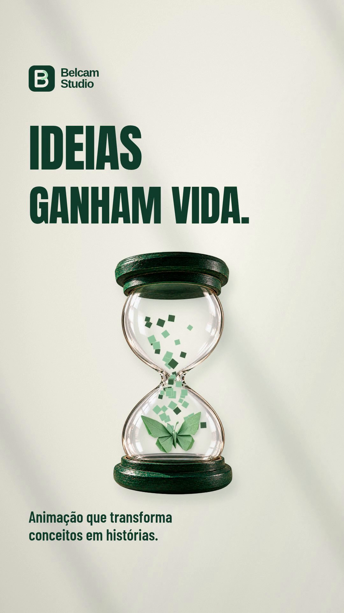

# Belcam Studio — Stories

**3 adaptações de feed + 6 dicas anteriores.**

3 de 33 adaptações disponíveis.

[Voltar ao acervo](../README.md) · [Abrir feed](../feed/README.md)

## Artes adaptadas

| | | |
| :---: | :---: | :---: |
|  19 de asas a sua historia |  20 pense alem da moldura |  21 ideias ganham vida |

## Dicas anteriores

| | | |
| :---: | :---: | :---: |
|  01 videos personalizados |  02 motion com intencao |  03 mascotes com personalidade |
|  04 avatares e personagens |  05 videos explicativos |  06 criacao para as redes |

## Motions e projeto editável

[Baixar 01-de-asas-a-sua-historia](motions/01-de-asas-a-sua-historia.mp4?raw=true)

[Baixar 02-pense-alem-da-moldura](motions/02-pense-alem-da-moldura.mp4?raw=true)

[Baixar 03-ideias-ganham-vida](motions/03-ideias-ganham-vida.mp4?raw=true)

[Projeto editável dos motions](motions/Belcam-Studio-Projeto-Editavel.zip?raw=true)

## Textos de apoio

- [sugestoes-de-enquetes](textos/sugestoes-de-enquetes.txt)
- [textos-dos-stories](textos/textos-dos-stories.txt)
